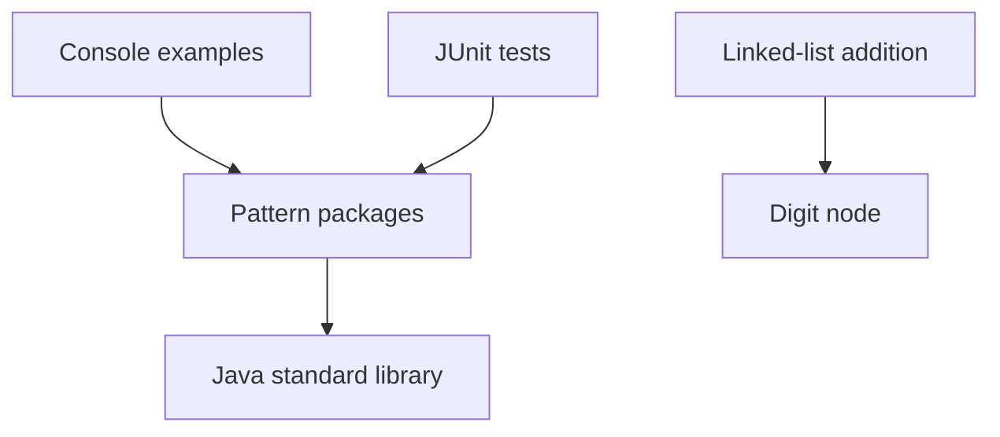

# Architecture and engineering decisions

## Scope

This repository is an in-process learning library. Its consumers are Java callers,
JUnit tests, and console examples. There is no persistent state, network protocol,
deployment service, or runtime configuration. The `principles` and `solid`
packages contain standalone teaching examples with local in-memory state.

The central design goal is that each algorithm can be read, called, and tested
independently. A single Maven module keeps the build and navigation proportional
to the project.

## Dependency direction

Each pattern package owns its implementations. There are no cross-pattern runtime
dependencies. The linked-list package owns the public digit node; tree and
general-list algorithms expose public static nested node models. Console
output belongs to the examples entry point or standalone `main` demos, while
computation methods only compute and return results.

## Decisions

| Decision | Reason | Consequence |
| --- | --- | --- |
| One Maven module with conventional source roots | Repeatable command-line and IDE builds | A single test lifecycle covers the library |
| Lowercase pattern packages | Discoverability and Java naming conventions | Existing question-number imports must migrate |
| JDK-only production code | Algorithms stay easy to reuse | JUnit is restricted to test scope |
| Java 8 source and bytecode baseline | Existing environment runs Java 8 | CI also exercises newer JDKs |
| Stateless core algorithms | Keep solver calls independent | Upstream teaching examples retain their own mutable state and local node models |
| No generic solver interface or dependency injection | Problem signatures differ substantially | New problems add ordinary classes and focused tests |
| Explicit input and arithmetic contracts | Failures are predictable | Invalid input may now throw a documented exception |
| Checked int products | Preserve simple learning signatures | Some mathematically representable outputs can still be rejected when an intermediate product exceeds int range |
| Caller guarantees for sorting and acyclic lists | Preserve intended complexity and avoid redundant traversal | Violating a precondition has no supported result |
| Preserve upstream teaching examples and tests | Keep all newer study material during integration | Design-principle examples remain separate from algorithm contracts |
| Explicit in-place operations | Preserve the purpose of grid traversal and list reversal | Their caller-owned inputs change; interval merging instead copies its inputs |
| Standard Maven wrapper | Make builds independent of a system Maven installation | Wrapper downloads Maven 3.9.9 on first use |
| Preserve nested tree and general-list models | Make APIs usable without breaking nested type names or coupling pattern packages | Values are immutable; callers connect and algorithms modify public links |
| Reject nonfinite validation-example state | NaN bypasses ordinary comparisons and infinity breaks finite invariants | Invalid operations fail before mutation, including deposit overflow |
| Focused quality gates | Catch common mistakes while keeping contrasting teaching examples usable | Checkstyle and PMD analyze main and test sources during verify |
| Report coverage without a percentage gate | Expose gaps without encouraging tests of incidental implementation details | JaCoCo includes all production classes, including demos; review the report alongside behavioral tests |

## Correctness boundaries

Median partitioning uses sentinels at array boundaries and a long sum for the two
middle values. Target-sum lookup uses long prefix sums. Pair search compares a long
sum to the target. Maximum-subarray and trapped-water results are accumulated in
long values and checked when converted to int.

Digit addition reads both lists independently and returns the first actual result
node, excluding the dummy head. It supports digit counts beyond primitive numeric
ranges. Conversion helpers intentionally support only nonnegative int values and
must not be used as an arbitrary-length addition implementation.

Stair counting allows 0..45 because 46 steps exceed an int result. The default
variant iterates with constant space; tabulation remains available for comparison.

The 132 detector scans right to left. A decreasing stack holds candidates for
the largest value in a pattern. Popped values establish a candidate middle value;
a later smaller value completes a strictly ordered pattern.

Interval merging sorts copied intervals using `Integer.compare`, avoiding
subtraction overflow and input aliasing. Recursive grid and tree examples retain
their educational implementations; deep traversals can exhaust the JVM stack.

The Java 8 baseline includes API compatibility, not only bytecode version.
`OptionalInt.orElseThrow` uses the supplier overload available on Java 8. The
Maven project sets UTF-8 explicitly, including for Unicode teaching comments.

## Verification and change policy

The Maven wrapper's `verify` lifecycle checks basic style, compiles production
code, runs JUnit tests, checks selected PMD rules, reports coverage, and builds
the jar. An installed Maven can run the same lifecycle.
Tests cover examples, invalid inputs, empty inputs, arithmetic boundaries,
carry propagation, and selected input-preservation guarantees. Seeded randomized
tests compare median partitioning and monotonic-stack detection with independent
sorting and exhaustive-search oracles.

Consumer-package tests exercise tree traversal, cycle detection, midpoint search,
and reversal through public node APIs. Numeric tests cover NaN, infinities,
finite overflow, absolute zero, and rejection without state changes. Order city
lookup delegates through Customer so specialized customer behavior is respected.

Checkstyle checks whitespace, control-flow braces, explicit type imports, and selected structural
mistakes. PMD checks focused null, comparison, control-flow, and import rules.
Both analyze tests as well as main sources and fail on violations. These are
bounded checks, not comprehensive static verification. The JaCoCo report under
`target/site/jacoco` provides line and branch evidence without a blanket threshold.

CI runs Java 8, 17, and 21. CI status is evidence only after the workflow executes;
a committed workflow alone does not establish a passing remote build.

Changes to package names, parameter or result types, input behavior, and overflow
behavior must be reflected in the affected README contracts and explained in the
review description, including compatibility impacts. Add modules or runtime
dependencies only when a concrete consumer requirement justifies them.
